# Enterprise MarTech / AI Control Plane

CRM, consent, scoring and revenue systems can all change customer state. The control plane determines which source owns each fact, which customer an event belongs to, whether a state transition is valid and whether an action is still authorized at execution time.

**Tools execute. The control layer determines what is true.**

The implementation combines canonical identity, source provenance, No-Regress Logic, consent, approval, durable execution and recovery across independent systems. It uses synthetic data and keeps AI agents outside source authority and downstream credentials.

Field ownership blocks unauthorized overwrites. Permission and approval are checked again before dispatch. Lost responses are reconciled against receiver receipts before any retry.

**Failure case:** A downstream system commits an action but loses its acknowledgment. The control plane looks up the stable effect ID and finds the existing receipt rather than issuing a second effect. After a database restore, independent receipts must reconcile before services can resume.

Start with the [current executed tests](docs/evidence/dependency-isolation/arrival-review/README.md#verification), [workload results](docs/evidence/enterprise-workload.json) and [recovery design](docs/cloud-operations.md). AWS infrastructure, service identities and release controls are defined separately from the isolated native acceptance run.



## Governing changes across business systems

**Professional application:** I have designed and delivered shared integration and governance infrastructure for **private equity sponsors and multi-brand operating companies**, connecting acquired businesses through centralized control layers without requiring every company to abandon its existing software. This public Python/PostgreSQL implementation demonstrates the stateful execution, source authority, identity resolution and recovery controls applied in those environments. Field ownership and No-Regress Logic prevent operational updates from overwriting authoritative sales owners or moving advanced deals backwards.

This Python/PostgreSQL control plane implements stateful middleware: canonical identity, source authority, No-Regress Logic, durable intent, fenced workers and independent receipts. Stable effect IDs and audit trails support idempotent recovery after uncertain writes. Current authorization governs new actions; an existing receipt establishes what already happened. Local tests block recovery when downstream effects outlive control state. Separate AWS evidence records native SQL checks and an available retained-backup restore; the final restored-state comparison remains unverified. These controls apply across enterprise applications and AI-enabled workflows.

[Execution and recovery](docs/failures.md) · [Recorded AWS boundary](docs/evidence/aws-readiness/retained-two-instance/native-outcome/README.md)

## Engineering choices and tradeoffs

- **AI can propose, not authorize.** Agents submit typed proposals. Scoped identities and a separate executor enforce field ownership, policy and credential boundaries. [Trust decisions](docs/architecture.md).
- **Receipts govern retries.** A timeout does not establish whether an effect committed. The system saves the intent and effect ID before dispatch, checks the receiver's receipt and revalidates authority before another attempt. Delivery is **at least once with idempotent effects under the receiver contract**. [Failure semantics](docs/failures.md).
- **Recovery requires reconciliation.** A restored control database may predate committed downstream effects. Local remote-ahead tests block resumption when those states disagree. [Recovery design](docs/cloud-operations.md) · [Recorded blocked case](docs/evidence/remote-ahead-restore.json).
- **Identity safety limits throughput.** A global admission lock simplifies resolution at the cost of concurrency. Measured synthetic throughput and criteria for pooling or partitioning are documented. [Capacity boundaries](docs/capacity.md).

## Measured behavior under overload

The destination-capacity extension keeps one unavailable integration from consuming every worker or turning a shared request allowance into one allowance per process. A finite owner-to-destination registry, immutable routing, PostgreSQL-coordinated permits and bounded admission preserve the original outbox and receipt contract.

Four actual five-minute runs offered **20,000 synthetic proposals** to separate local HTTP receivers. All **12,035 admitted actions** reconciled to one effect each; **7,965 proposals were explicitly rejected at the backlog limit**. Three runs injected sustained HTTP 429/503 faults while the healthy destination continued. Shared budgets, concurrency, alert readback, worker-death recovery and exact destination reconciliation remain inspectable. These are measured local operating limits, not production capacity or cloud acceptance. Permit issuance stayed within ten per destination per assigned UTC-second window; receiver journals peaked at **11 arrivals**, with eight buckets above ten. This is not a strict provider-arrival or rolling-window guarantee. [Rate evidence](docs/evidence/dependency-isolation/arrival-review/README.md).

[Executed results and incident timelines](docs/evidence/dependency-isolation/portability-fix/README.md) · [Capacity semantics and reproduction](docs/dependency-isolation.md).

## The invariants

| Boundary | Enforced behavior |
|---|---|
| Identity | Source record IDs resolve to canonical UUIDs. Matching email creates review candidates, never an automatic merge. |
| Authority | Field owners and source sequences determine accepted state. A later event cannot grant a source authority it does not have. |
| No-Regress | Lifecycle advances through Lead → MQL → SQL → Opportunity → Customer; stale regression is refused. |
| Consent and approval | Protected writes are denied. Marketing needs explicit approval bound to customer revision, policy and expiry. Current permission is checked again before dispatch. |
| Execution | A durable intent, stable effect ID and immutable payload survive retries. Leases distribute work; tokens fence stale workers. |
| Recovery | Unknown outcomes query the original receipt first. Restored control state is compared with the independent downstream ledger before services resume. |
| Accountability | Decisions retain actor, source evidence, provenance and policy hash. Application roles cannot rewrite audit history. |

## Execution and failure semantics

The API validates a proposal and commits eligible work to PostgreSQL. A worker claims it, locks the customer, rechecks permission, and commits the dispatch intent **before** making an HTTP request. The downstream commits its business effect and idempotency receipt together.

If the response disappears or the worker dies, the next worker looks up the same effect ID. A matching receipt establishes an existing fact; it does not authorize another action. An absent receipt requires a fresh permission check before retry. Conflicting identities, permanent rejection and exhausted retry budgets become reviewable exceptions.

Delivery is **at least once with idempotent effects under the downstream adapter contract**. Consent is enforced at dispatch authorization; an independently running remote system cannot recall an already in-flight request. See [precise failure semantics](docs/failures.md) and the [execution diagram](docs/diagrams/04-execution.svg).

## AWS operating architecture

**Native AWS acceptance:** The [first SQL run](docs/evidence/aws-readiness/native-sql/README.md) verified independent PostgreSQL receipts, duplicate safety and read-only permission denials. A third concurrent RDS instance was denied by the Free-plan quota. A [second run](docs/evidence/aws-readiness/retained-two-instance/native-outcome/README.md) used retained backups to stay within two instances: the disposable source was deleted and its restored replacement was observed `available` alongside the receipt database. The final native post-restore fail-closed comparison **was not recorded**.

RDS service-contract issues found during the run were fixed in the committed controller and covered by regression tests. That revised code has not been run against AWS. [Historical local proof](docs/evidence/aws-readiness/retained-two-instance/README.md) remains tied to its original revision. The [production architecture](docs/cloud-operations.md), including HTTP services and release/failover operations, was not deployed. Active acceptance resources and the cleanup guard were removed; secret/key deletions were pending and final billing had not settled. [Execution and teardown record](docs/evidence/aws-readiness/retained-two-instance/native-outcome/README.md).

Earlier stages: [Ohio preflight](docs/evidence/aws-readiness/ohio/README.md), [guard and image checks](docs/evidence/aws-readiness/guard-native/README.md), [RDS bootstrap](docs/evidence/aws-readiness/rds-bootstrap/README.md).



- Separate Fargate services for API, workers, downstream and a read-only observer; one-shot migration and verification tasks.
- Immutable ECR tags and digest-qualified task revisions, bound to source commits. Protected GitHub OIDC releases use short-lived authority.
- Two private, encrypted PostgreSQL RDS instances keep control state and downstream receipts in independent recovery domains. Multi-AZ, 14-day PITR, deletion protection and TLS are configured.
- Private HTTPS ingress, explicit service-to-database security groups, and private ECR/Secrets/Logs endpoints. No public database, public task address or NAT dependency.
- Secrets Manager values are created and retrieved at runtime. Terraform contains secret identifiers, never application passwords or token values.
- CloudWatch tracks eligible-work age, unresolved outcomes, retries, reconciliations, dependency errors and worker heartbeat. Metrics have only environment/service dimensions.

[Infrastructure and deployment](infra/README.md) covers foundation state, enterprise network/PKI prerequisites, IAM grants, the immutable image path and controlled releases. [Trust boundaries](docs/diagrams/03-trust-boundaries.svg) show which service can access each authority.

### Recovery is a business-integrity gate

A successful database restore alone is insufficient. Downstream effects can be newer than the restored local record. The operating tools drain admission and execution, restore into a **new** instance, bind its endpoint, and compare all local intents with independent receipts. Missing intents, mismatched hashes and missing acknowledged receipts keep services closed. A saved pass report cannot reopen them: resume runs a fresh verification task.

[Restore and reconciliation runbook](docs/cloud-operations.md) · [Recovery diagram](docs/diagrams/06-database-restore.svg) · [Executed remote-ahead case](docs/evidence/remote-ahead-restore.json)

## Workload and capacity

| Validation layer | Purpose and observed result |
|---|---|
| Exact correctness suite | 323 current tests, preserving the original invariants and adding shared capacity, routed recovery, evidence and permission checks; real PostgreSQL and separate HTTP processes. |
| Enterprise workload | 1,000 customer accounts, 1,000 intents, four worker processes, 1,200 attempts; 950 unique effects, 50 intended permanent rejections, 50 lost acknowledgements reconciled, zero duplicate effects. |
| Measured local run | 19.3 seconds admission; 55.5 seconds drain; 18.0 intents/second during drain. HTTP admission p95: 63 ms. |
| Production capacity model | Explicit connection budgets, admission-lock limits, worker concurrency, retention, failure domains and scaling decision points. |

The workload has deterministic source records and fault schedules; timings and generated receipt IDs are observations. [Capacity and boundaries](docs/capacity.md) explains why a larger customer estate does not imply unbounded event throughput, and when pooling, partitioning or queue separation becomes justified.

## Run and verify

With Docker Compose v2:

```bash
docker compose run --build --rm demo
docker compose down
```

The demo asserts authority protection, the consent race and lost-acknowledgement recovery. To run the full suite in a container:

```bash
docker compose --profile test run --build --name control-proof verify
docker cp control-proof:/app/docs/evidence ./local-proof
docker rm control-proof
docker compose down
```

For native development, use Python 3.12 and a dedicated PostgreSQL 17 instance:

```bash
python -m venv .venv
# Activate .venv for your shell.
python -m pip install -r requirements.lock
python -m pip install --no-deps --no-build-isolation -e .
# CONTROL_ADMIN_DSN: a disposable demo database you own.
python scripts/local_demo.py
# TEST_ADMIN_DSN: a separate disposable database ending in _test.
python scripts/verify.py work/local-proof
```

The verifier deliberately recreates its test schemas. [Local operations](docs/operations.md) supplies exact environment examples. [Workload instructions](docs/capacity.md) use a separate empty database. Infrastructure validation needs Terraform 1.13.5 and Trivy 0.75.0, **no AWS credentials**:

```bash
python scripts/validate_infra.py
```

## Evidence and implementation map

| Review area | Entry point |
|---|---|
| Governance and transactions | [Architecture](docs/architecture.md), [governance](docs/governance.md), [source](src/controlplane/service.py) |
| Leases and reconciliation | [Worker](src/controlplane/worker.py), [failure model](docs/failures.md), [tests](tests/test_execution.py) |
| Deployment and security | [Terraform](infra/aws), [runtime bootstrap](src/controlplane/cloud.py), [release gate](src/controlplane/release.py) |
| Restore and operations | [Read-only comparison](src/controlplane/operations.py), [PITR tool](src/controlplane/restore.py), [runbook](docs/cloud-operations.md) |
| Verification | [Generated test proof](docs/evidence/verification.json), [infrastructure checks](docs/evidence/infrastructure/verification.json), [validation guide](docs/validation.md), [GitHub Actions](https://github.com/rlbsem/enterprise-martech-ai-control-plane/actions) |

The isolated guard, image bootstrap, native SQL runtime and retained-backup RDS restore executed and were subsequently cleaned up. The [final native recovery gate is unverified](docs/evidence/aws-readiness/retained-two-instance/native-outcome/README.md); production deployment and full application release/failover remain [environment acceptance checks](docs/cloud-operations.md).
