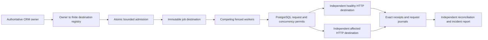

# Destination capacity and dependency isolation

An unavailable integration should not consume every worker or turn a shared API allowance into one allowance per process. This extension retains the PostgreSQL outbox and gives each explicitly registered destination a shared capacity boundary.

## Architecture



The proposal contract still contains no destination URL. Trusted deployment configuration maps the CRM-owned owner value to a registered destination. Each admitted proposal receives an immutable route. Later routing changes apply to new proposals; historical receipt lookup keeps the original destination. A changed customer revision prevents a new dispatch, while a matching historical receipt remains an existing fact.

`capacity.sql` is additive migration 2. Migration 1 and its checksum remain unchanged. Empty destination configuration retains the original single-destination behavior. Configure the new lane in a fresh disposable workspace; this implementation does not migrate historical unrouted work into a different downstream system.

## Request and backlog semantics

- A database row lock serializes permit decisions across all workers for a destination. Budgets use fixed UTC epoch-second buckets, with one request reserved for receipt lookup. Both GET and POST consume a separate permit. A backward clock movement cannot reopen an already consumed bucket; a fixed-window limit is not a rolling-window limit.
- Outstanding client permits cap concurrency. A permit survives process death and expires after 30 seconds; enabled clients require a timeout of at most five seconds. A remote handler may continue after its client disconnects, so the client bound is not a guarantee about arbitrary provider-side processing concurrency.
- Failed requests impose a shared cooldown. A 429's bounded numeric Retry-After applies across workers. Recovery attempts consume the same shared budget. Scheduling deferral does not consume another business retry attempt.
- Backlog admission is serialized per destination and counts pending jobs and unexpired approval reservations. Duplicate requests are resolved before the capacity check. A full destination cannot consume another destination's admission allowance. Terminal requeue requires another capacity check.
- Existing approval expiry, source revision, consent, immutable payload, retry exhaustion and lease fencing remain in force. The registry and routing configuration are trusted administrator state; this is not a hostile-process sandbox.

[Executed results and incident timelines](evidence/dependency-isolation/README.md).

The four qualifying runs use a 300-second window, 5,000 proposed actions and a ten-request fixed-window budget. Mixed faults return HTTP 429 in the first half of the injection window and HTTP 503 in the second. Isolated workers poll every 50 milliseconds while the original single-destination mode keeps its 500-millisecond idle poll. Capacity is fixed before worker startup.

Recovery with registered destinations requires readers for every configured destination plus the preserved `__legacy__` ledger. Supplying a single reader fails closed. All writers must be quiesced for this comparison; it does not establish a shared transactional snapshot across independent databases.

## Reproduction and evidence

The process-resource observer supports Windows and Linux. The acceptance runner uses only loopback PostgreSQL and HTTP. It creates uniquely named disposable databases, starts separate destination and worker processes, writes a workload protocol before traffic, retains independently observed requests/effects, and drops only its generated databases in finally cleanup. Runtime databases, credentials and raw subprocess logs remain under ignored `work/`.

After the existing local bootstrap has provisioned the restricted synthetic roles, run from the repository root using the installed dependencies:

```text
python scripts/isolation_acceptance.py --admin postgresql://postgres@127.0.0.1:5432/postgres --output work/new-isolation --duration 300 --proposals 5000 --request-limit 10 --fault mixed
python scripts/check_isolation.py work/new-isolation/observations.json
```

Use a new output directory for every run. The connection in this example is an isolated local administrator, not an instruction to use a vendor or business database. The protocol records exact source hashes and rejects source changes during execution. The 60-second/100-proposal CI smoke profile is a harness check and does not substitute for sustained acceptance. Full observations distinguish offered, admitted, rejected and terminal work; rejected admission is not a successful delivery.

The separate native AWS archive keeps its original limits, including the missing native post-restore fail-closed result. This extension does not contact AWS, perform inference, send prospect communications or establish production SLOs.
