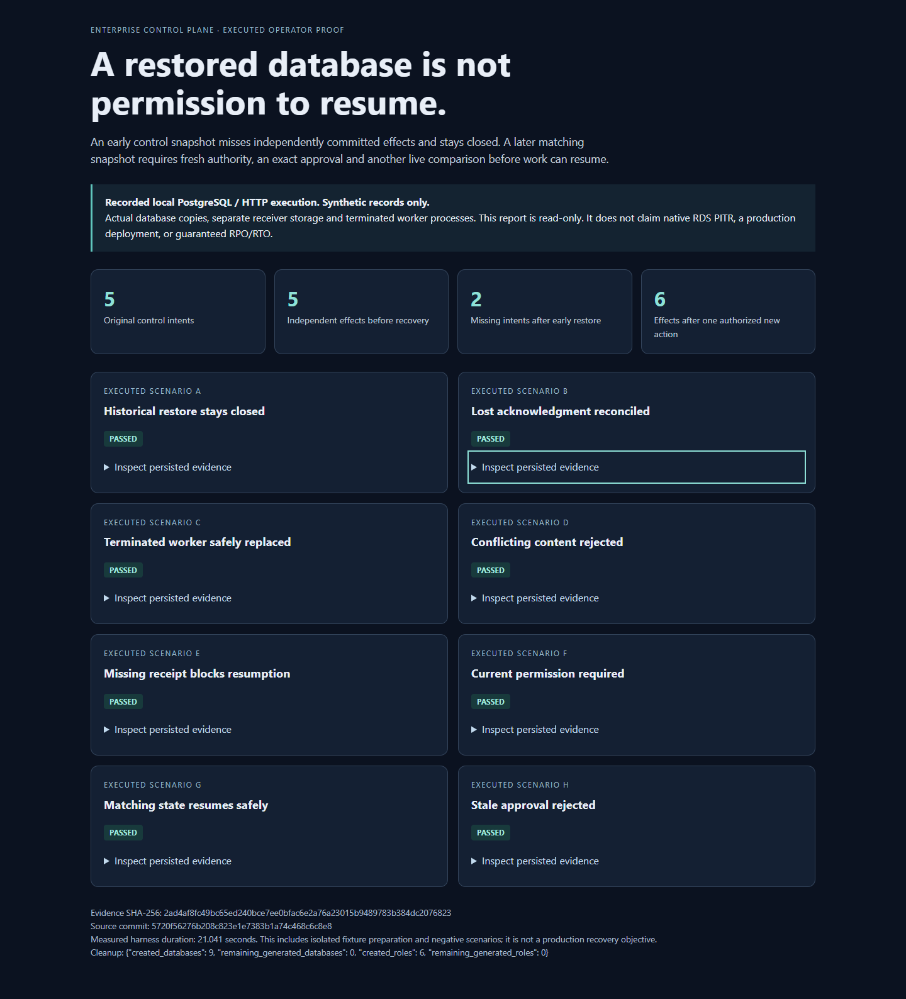

# Cloud recovery acceptance

This package separates new recovery verification from historical AWS observations.

**368 local tests passed, with zero failures and zero skips.** The recovery harness executes all eight scenarios against real PostgreSQL databases and independent HTTP/worker processes. The versioned native application tasks also execute against local database restores. AWS controller tests use service contracts/mocks; they are not native cloud results. Infrastructure availability is never substituted for application acceptance.

| Record | Executed scope |
|---|---|
| [Structured recovery proof](local-2026-10-27/acceptance.json) | Eight actual local snapshot/HTTP/process scenarios; exact source `5720f56276b208c823e1e7383b1a74c468c6c8e8`; five original effects, two missing early-restored intents, six effects after one new authorized action |
| [Standalone operator report](local-2026-10-27/operator-report-v2.html) | Download/open as HTML; read-only expandable evidence, not a live cloud deployment |
| [Current desktop/mobile captures](local-2026-10-27/browser-03/provenance.json) | Actual Chromium 156 rendering, both widths, evidence drilldowns and keyboard access; no external requests or page errors; earlier rendering retained unchanged |
| [Regression verification](regression-2026-10-27/verification.json) | 368 tests, real PostgreSQL and separate HTTP servers; [source binding](regression-2026-10-27/execution-binding.json) pins `bfa3e00ea17871b163f90d8874ddf42bceb348b7` and 98 source files |
| [Fresh regression recovery output](regression-2026-10-27/cloud-recovery.json) | Another actual execution of all eight scenarios under that regression source; separate from the earlier standalone capture |
| [Infrastructure verification](infrastructure-2026-10-27/verification.json) | 14 successful commands: four Terraform roots, mock-provider assertions, HIGH/CRITICAL configuration checks and secret scan; [21-file source binding](infrastructure-2026-10-27/execution-binding.json) |
| [Integrity rejection checks](integrity-negatives-2026-10-27.json) | Three controlled private-copy failures: changed artifact bytes, an unlisted file and a false source binding all rejected; originals unchanged |
| [Reduced native plan](native-plan-2026-10-27/README.md) | Authenticated read-only AWS preflight and USD 11.2868 conservative estimate; no new resources or native recovery claimed |

The matching-state procedure explicitly calls the restricted coordinator's approval operation with the exact fresh proof. In the synthetic acceptance, the finite driver exercises this operator authority; it does not claim a human approval UI or a staffed production process.

[Implementation and reproduction](../../cloud-recovery.md) · [Original native outcome](../aws-readiness/retained-two-instance/native-outcome/README.md) · [Prior runtime source bindings](prior-runtime/README.md)

The recovery gate and versioned native application lane change source code previously referenced by immutable workload records. Nine exact former source files are retained at their original revision, without rewriting the workload observations, source maps or hashes. Earlier workload timings do not measure the new gate. New verification must identify its own source revision and file hashes.

Native AWS application recovery remains pending execution. The connected AWS account has been checked read-only; no new infrastructure is implied by this evidence entry point.

Recheck this package with `python scripts/check_recovery.py`. It validates the complete [artifact manifest](artifact-manifest.json), pinned executed Git sources, standalone browser provenance and full regression counts. The infrastructure CI job fetches complete history and runs it separately from current-code tests. Existing October 19 native evidence and its limitations remain unchanged.
